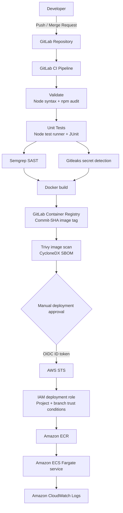

# GitLab DevSecOps Architecture

## Security boundaries

- GitLab CI runners execute repository-controlled build and scan commands.
- GitLab Container Registry stores the immutable commit-SHA image used by the deployment.
- GitLab OIDC tokens are exchanged for short-lived AWS credentials through STS.
- The IAM role is restricted to the GitLab project and protected default branch.
- The deployment is a manual action and requires explicit AWS variables.
- ECS deployment reuses the existing Project 02 service; it does not provision new network or compute infrastructure.
