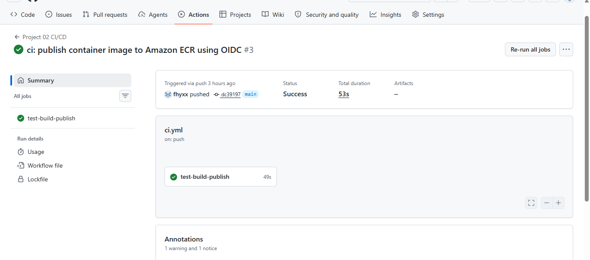
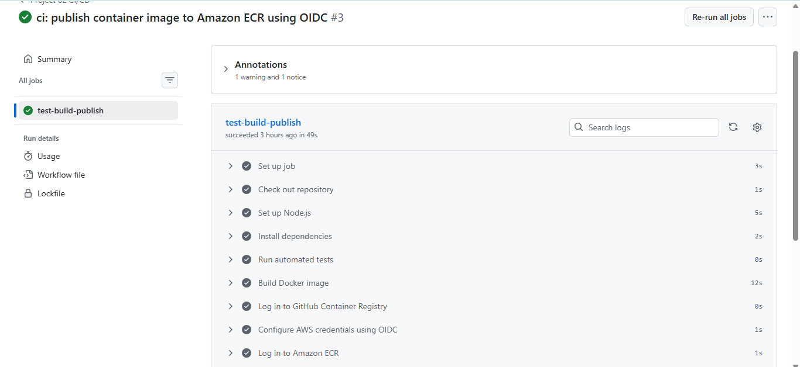
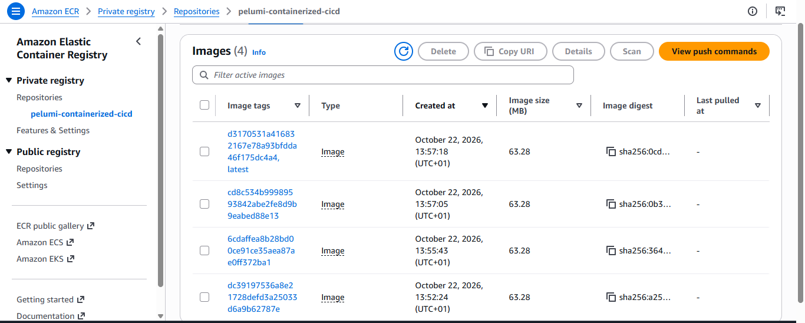
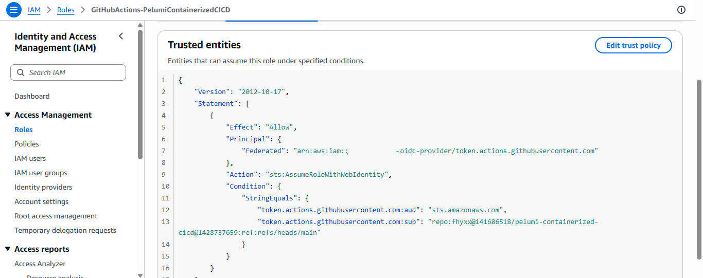
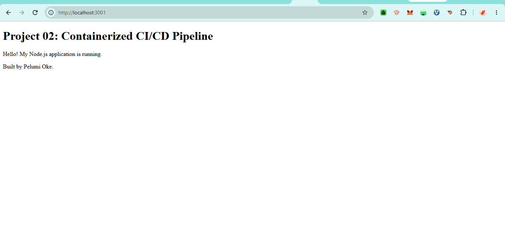
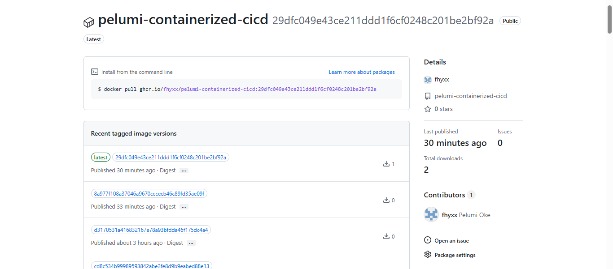

# Project 02 — Implementation Evidence

This folder documents the **Containerized CI/CD Pipeline** through genuine screenshots captured during implementation. The GitHub Actions workflow runs automated tests, builds a Docker image, and publishes image tags to GitHub Container Registry (GHCR) and Amazon Elastic Container Registry (ECR). GitHub OIDC is used for AWS authentication without storing long-lived AWS access keys.

[Back to the project README](../README.md) · [Verified successful workflow run](https://github.com/fhyxx/pelumi-containerized-cicd/actions/runs/39781843020)

## 01 — Successful GitHub Actions workflow

*Evidence of the CI/CD workflow run and its successful completion.* [View image](01-github-actions-success.png) · [Open the verified run](https://github.com/fhyxx/pelumi-containerized-cicd/actions/runs/39781843020)

## 02 — Automated tests

*Evidence of the automated test stage. The project has three automated tests.* [View image](02-automated-tests.png)

## 03 — Amazon ECR image tags

*Amazon ECR private repository `pelumi-containerized-cicd` in `us-east-1`, with a `latest` tag and commit-SHA image tags. This screenshot was visually reviewed.* [View image](03-ecr-image-tags.png)

## 04 — GitHub OIDC IAM role

*Documents the AWS IAM role used for GitHub Actions OIDC authentication and the intended repository/branch trust restriction.* [View image](04-github-oidc-role.png)

## 05 — Local Docker container

*Documents the containerized application running locally, served on port 3001 of the host.* [View image](05-local-container-running.png)

## 06 — GitHub Container Registry package (optional)

*Additional evidence of the container image published to GitHub Container Registry.* [View image](06-ghcr-package.png)

## Verification and security notes

- All six screenshot files are present in this folder. The ECR screenshot was visually reviewed; the other images are linked as uploaded and their contents have not been independently visually inspected here.
- The [successful workflow run](https://github.com/fhyxx/pelumi-containerized-cicd/actions/runs/39781843020) was independently checked through GitHub workflow metadata.
- Do not include passwords, tokens, access keys, session credentials, or repository secrets in screenshots.
- This project demonstrates build, test, and registry publishing. It does **not** claim an ECS/Fargate deployment. No NAT Gateway or long-running paid AWS workload is required to reproduce this evidence.
