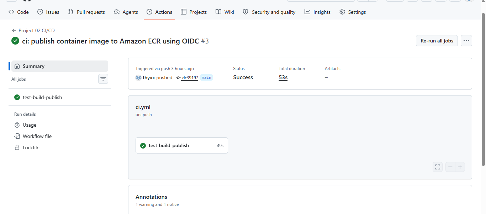
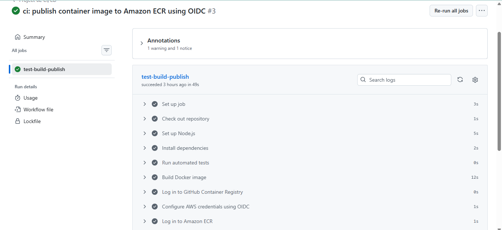
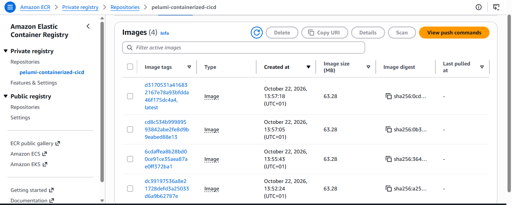
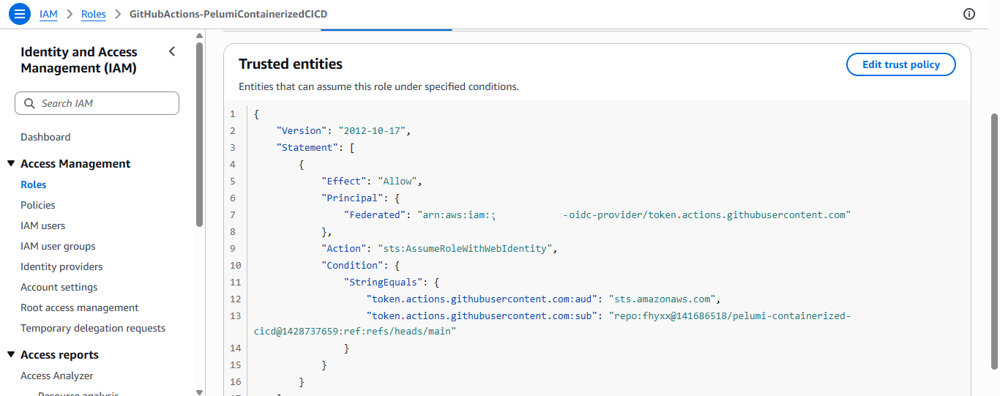
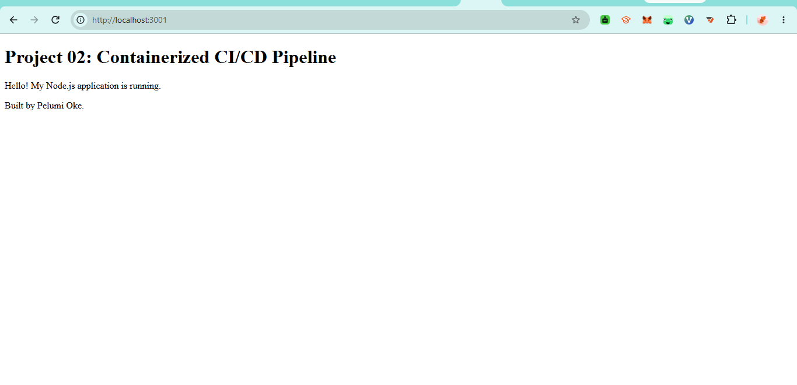
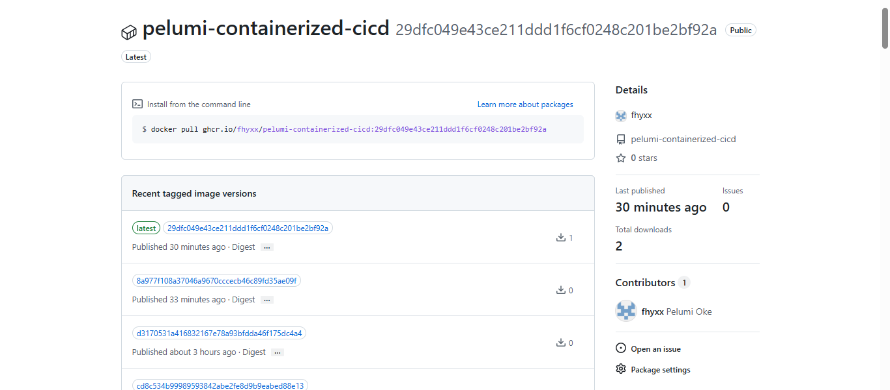

# Project 02 — Implementation Evidence

This folder contains screenshots documenting the **Containerized CI/CD Pipeline and ECS Fargate deployment**. The workflow tests the Node.js application, builds a Docker image, publishes it to Amazon ECR and GitHub Container Registry (GHCR), and deploys the commit-specific ECR image to Amazon ECS using GitHub OIDC.

[Back to the project README](../README.md) · [Open successful ECS deployment run #41638589404](https://github.com/fhyxx/pelumi-containerized-cicd/actions/runs/41638589404)

## Existing implementation evidence

### 01 — GitHub Actions workflow

Documents the CI workflow completion. [View image](01-github-actions-success.png)

### 02 — Automated tests

Documents the three automated application tests. [View image](02-automated-tests.png)

### 03 — Amazon ECR image tags

Shows the private ECR repository and image tags. [View image](03-ecr-image-tags.png)

### 04 — GitHub OIDC IAM role

Documents the IAM role used by GitHub Actions. [View image](04-github-oidc-role.png)

### 05 — Local Docker container

Documents the application running locally in Docker. [View image](05-local-container-running.png)

### 06 — GitHub Container Registry package

Documents the published GHCR package. [View image](06-ghcr-package.png)

## ECS deployment evidence to add

Capture and add the following screenshots after deployment verification:

| Suggested filename | What it should prove |
|---|---|
| `07-ecs-cluster-service.png` | ECS cluster and service showing ACTIVE status and desired/running count |
| `08-ecs-task-running.png` | Running Fargate task and task-definition revision 2 |
| `09-ecs-task-networking.png` | Task networking details, including assigned public IP |
| `10-cloudwatch-logs.png` | Application log stream in `/ecs/pelumi-project02` |
| `11-live-application.png` | Browser showing the app response |
| `12-github-ecs-deployment.png` | GitHub Actions run #41638589404 showing successful ECS deployment |

## Verification record

On 3 November 2026, AWS CLI checks confirmed:

- ECS service `pelumi-project02-service` is `ACTIVE`.
- Primary deployment rollout state is `COMPLETED`.
- One task is desired and one is running, with zero pending tasks.
- The service reported that it had reached a steady state.
- Task definition revision `pelumi-project02-task:2` is running.
- Container `pelumi-app` is `RUNNING`.
- A direct HTTP request to the task public IP on TCP port 3000 returned **HTTP 200** with the expected Project 02 HTML.

The ECS task health field returned `UNKNOWN` because no container health check is configured. Do not describe this as a passing ECS container health check.

## Security and evidence handling

- Do not include passwords, access keys, session credentials, tokens, or repository secrets in screenshots.
- The demo currently uses a public inbound TCP 3000 security-group rule for direct validation. Restrict or remove this rule when public access is no longer required.
- The task public IP is ephemeral and may change when ECS replaces the task.
